# smartcaptcha-ai-icon-solver

Распознавание иконок на изображениях с помощью YOLOv8: генератор синтетического
датасета, обучение детектора и десктопный интерфейс для анализа результатов.

**139 классов иконок · 50 000 синтетических изображений · mAP50 0.995 / mAP50-95 0.940 (val) ·
40 мс на кадр на CPU, 7 мс на GPU**

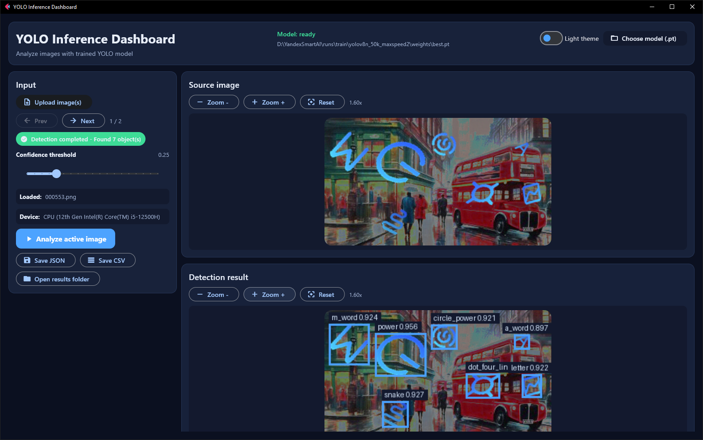

## Содержание

- [Интерфейс](#интерфейс)
- [На чём построено](#на-чём-построено)
- [Как устроено решение](#как-устроено-решение)
- [Почему именно так](#почему-именно-так)
- [Как генерируются данные](#как-генерируются-данные)
- [Как обучалась модель](#как-обучалась-модель)
- [Результаты](#результаты)
- [Быстрый старт](#быстрый-старт)
- [Команды подробно](#команды-подробно)
- [Структура проекта](#структура-проекта)
- [История экспериментов](#история-экспериментов)
- [Лицензия и правовая информация](#лицензия-и-правовая-информация)

## Интерфейс

Десктопное приложение на Flet (Flutter): загрузка изображений, запуск модели, просмотр
рамок, сводка, графики и экспорт отчётов. Есть тёмная и светлая темы.

### Главное меню и панель ввода

| Элемент | Что делает |
|---|---|
| **Model: ready** + путь | какая модель загружена; по умолчанию — последняя выбранная вручную, иначе `best.pt` из `runs/train` с наибольшим mAP50-95 |
| **Light theme** | переключение тёмной и светлой темы, выбор запоминается |
| **Choose model (.pt)** | выбор другой модели через системный диалог |
| **Upload image(s)** | загрузка одного или нескольких PNG/JPG |
| **Prev / Next**, `1 / 2` | переход между загруженными изображениями |
| Статус-чип | `Ready` → `Running YOLO inference…` → `Detection completed — Found N object(s)` / `No objects detected` / `Inference error` |
| **Confidence threshold** | порог уверенности 0.05–0.95; фильтрует рамки, таблицу, графики и экспорт без повторного запуска модели |
| **Loaded / Device** | текущий файл и процессор, на котором идёт инференс |
| **Analyze active image** | запуск модели для активного изображения |
| **Save JSON / Save CSV** | отчёт с учётом текущего порога |
| **Open results folder** | папка `gui_outputs/` с аннотированными изображениями |

Изображения справа масштабируются кнопками **Zoom − / Zoom + / Reset** и колесом мыши,
перетаскиваются мышью.

### Карточки результата

<table>
<tr>
<td width="50%" valign="top">
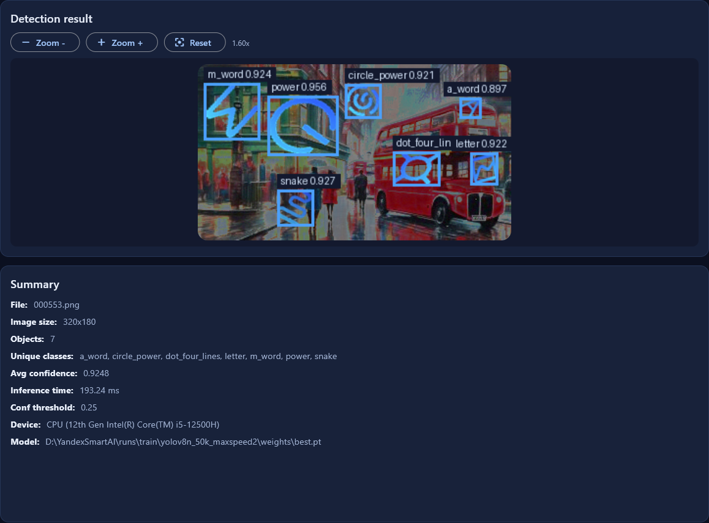<br>
<b>Результат и сводка.</b> Найденные объекты с классом и уверенностью; файл, размер,
число объектов, список классов, средняя уверенность, время инференса, порог, устройство и модель.
</td>
<td width="50%" valign="top">
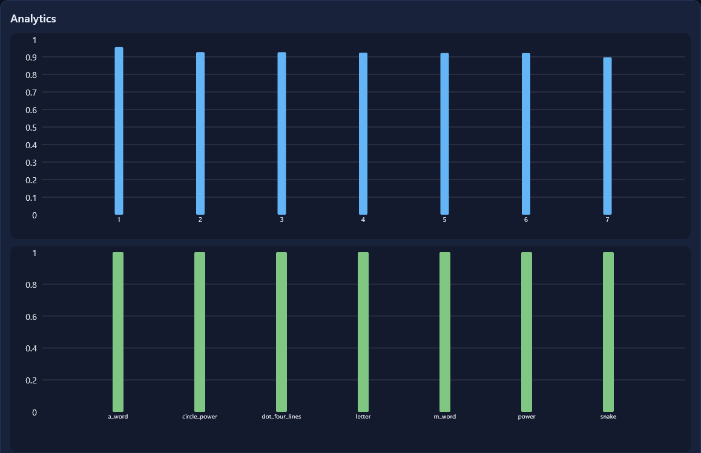<br>
<b>Аналитика.</b> Уверенность по каждой детекции (красным — ниже 0.8) и количество
объектов каждого класса. При наведении на столбец под графиками появляются класс,
уверенность и координаты объекта.
</td>
</tr>
<tr>
<td width="50%" valign="top">
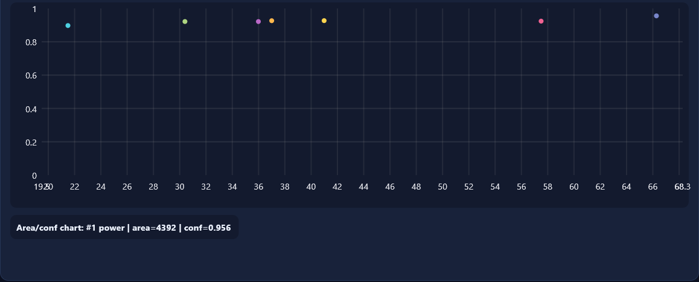<br>
<b>Размер ↔ уверенность.</b> Каждая точка — объект: по горизонтали √площади рамки,
по вертикали уверенность. По клику — класс, площадь и уверенность объекта.
</td>
<td width="50%" valign="top">
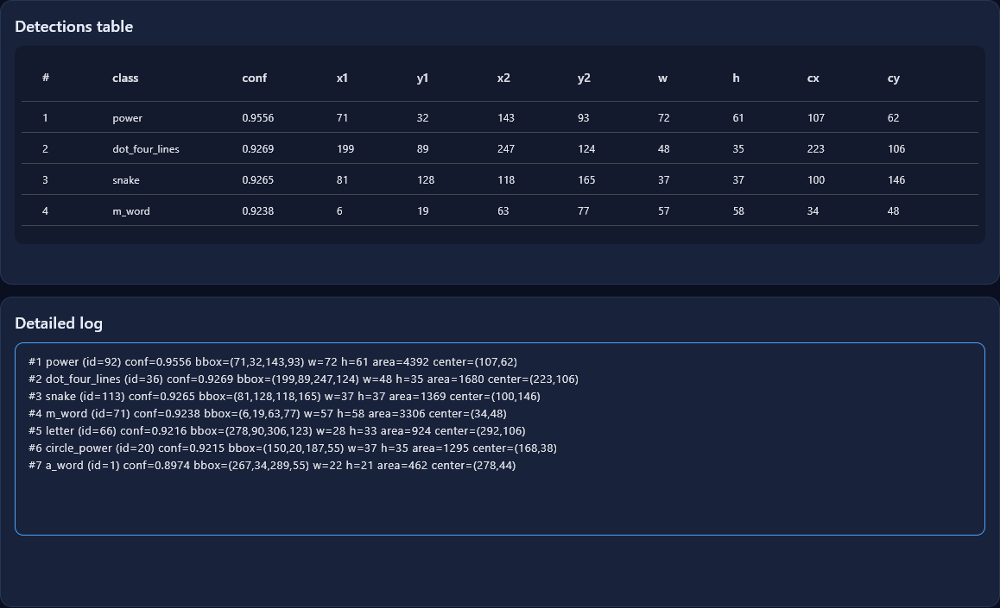<br>
<b>Таблица и журнал.</b> Координаты рамок (x1, y1, x2, y2), размеры и центр каждого
объекта — то же, что попадает в CSV/JSON.
</td>
</tr>
</table>

<details>
<summary><b>Светлая тема</b></summary>

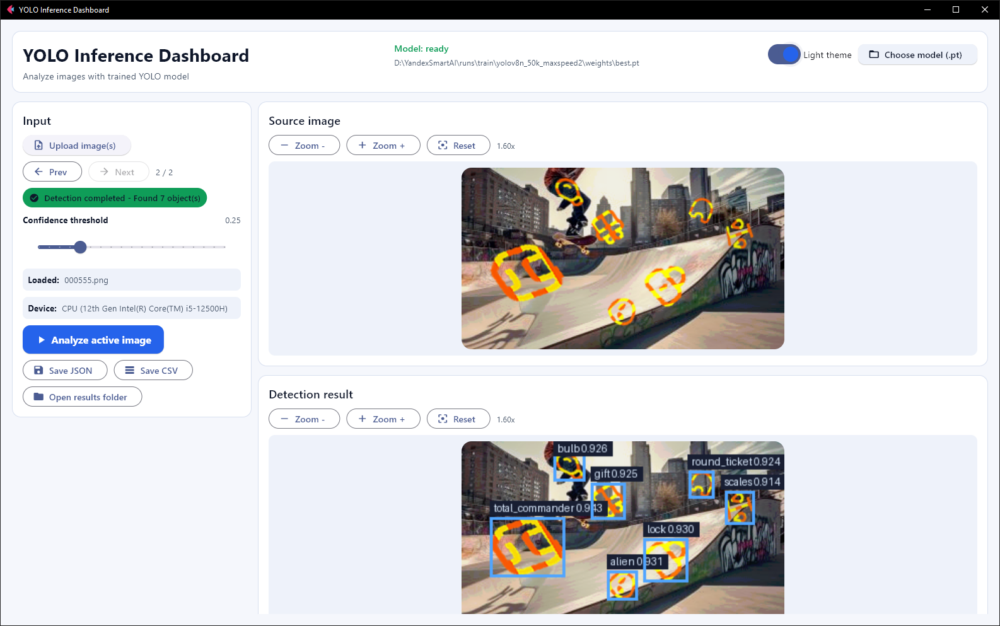

</details>

## На чём построено

| Слой | Технология | Зачем |
|---|---|---|
| Язык | Python 3.10 | экосистема ML, единый язык для генератора, обучения и GUI |
| Детектор | [Ultralytics](https://docs.ultralytics.com) 8.4.23, **YOLOv8n** | одноэтапный детектор: рамки и классы за один проход |
| Обучение | PyTorch 2.5.1 + CUDA 12.1 | обучение на GPU с mixed precision (AMP) |
| Генератор данных | Pillow 12, NumPy 2.2 | компоновка изображений, маски, градиенты, аугментации |
| Интерфейс | Flet 0.82 + flet-charts | нативное окно на Flutter из Python, встроенные графики и диалоги |
| Конфигурация | PyYAML, dataclasses | `data.yaml` для Ultralytics, параметры генерации в `config.py` |
| Тесты | unittest | 27 тестов: генерация, рамки, экспорт, выбор модели, обучение |
| Железо | RTX 4050 Laptop (6 ГБ), Intel i5-12500H | ноутбучная конфигурация — модель подобрана под неё |

## Как устроено решение

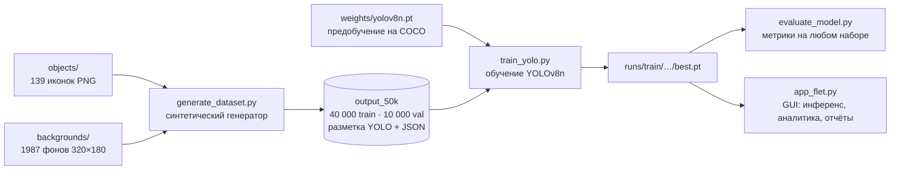

1. **Генератор** берёт чёрно-белые иконки и фоны, раскрашивает и трансформирует иконки,
   раскладывает по 6–8 штук на фон и сам записывает точные рамки.
2. **Обучение** дообучает предобученную на COCO YOLOv8n на этих данных.
3. **Оценка** считает метрики на любом размеченном наборе, включая реальные изображения.
4. **GUI** загружает лучшую модель и показывает результат человеку.

## Почему именно так

### Синтетические данные вместо ручной разметки

- Готового размеченного набора под эти 139 иконок нет. Ручная разметка 50 000 изображений —
  это около 350 000 рамок.
- Иконки в целевых изображениях — штриховые рисунки, которые перекрашены, повёрнуты,
  растянуты и наложены на фон. Этот процесс можно воспроизвести программно, и тогда
  **разметка получается точной и бесплатной**.
- Генератор даёт полный контроль: баланс классов, доля мелких объектов, трудные фоны,
  а один и тот же `--seed` воспроизводит датасет байт в байт.
- Цена подхода — разрыв между синтетикой и реальностью. Он смягчается сильными
  аугментациями, а проверяется только на реальных изображениях (`evaluate_model.py`).

### YOLOv8n как детектор

- **Задача — детекция, а не классификация.** На изображении 6–8 объектов, нужны и класс,
  и координаты каждого. Одноэтапный YOLO делает это за один проход сети.
- **Скорость.** 7 мс на кадр на RTX 4050 и 40 мс на CPU i5-12500H — GUI работает
  без видеокарты.
- **Размер.** 3.36 млн параметров и 9.8 GFLOPs: обучение с batch 32 помещается
  в 6 ГБ видеопамяти ноутбука.
- **Запаса качества хватает.** На валидации mAP50 = 0.995, то есть модель находит почти
  всё; более крупная YOLOv8s/m замедлила бы инференс без заметного выигрыша.
- **Готовый конвейер Ultralytics:** mosaic, AMP, метрики, графики, экспорт, единый формат разметки.

Отвергнутые варианты:

| Вариант | Почему не подошёл |
|---|---|
| Сопоставление с шаблоном (OpenCV `matchTemplate`) | не выдерживает поворот на ±90°, растяжение и перекраску градиентом |
| Классификатор + скользящее окно | много проходов сети на кадр, плохо с объектами разного масштаба |
| Двухэтапные детекторы (Faster R-CNN) | заметно медленнее при той же задаче, сложнее в обучении и развёртывании |

## Как генерируются данные

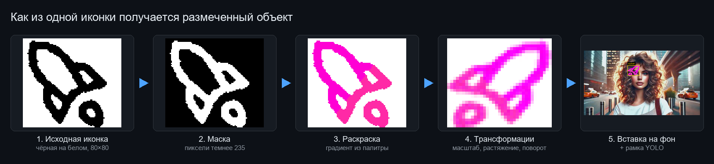

1. **Маска.** Иконки — чёрные штрихи на белом. Пиксели темнее 235 становятся объектом.
2. **Раскраска.** Модель должна узнавать форму, а не цвет, поэтому одна иконка получает
   десятки раскрасок: 20 двухцветных палитр и 4 вида градиента, плюс монохромные сцены.
3. **Трансформации.** Масштаб, растяжение, поворот, отражение, яркость, шум, резкость.
4. **Вставка.** Объекты разных классов раскладываются без пересечений; рамка берётся
   по видимому объекту.

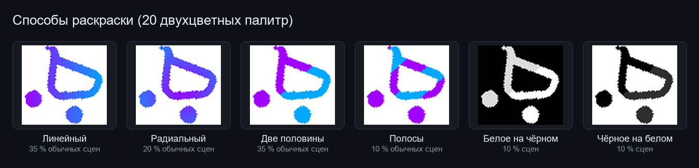

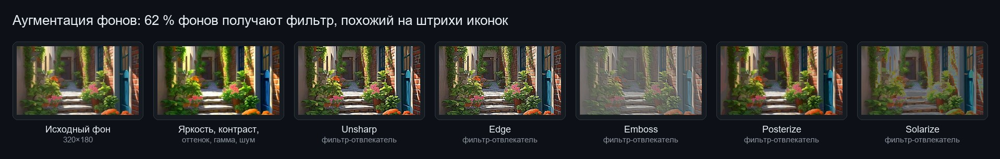

| Приём | Значение по умолчанию | Зачем |
|---|---|---|
| Объектов на кадр | 6–8, все разных классов | плотные сцены, как в целевых изображениях |
| Масштаб | 0.40–0.90 со смещением к мелким, 12 % «крошечных» 0.30–0.45 | мелкие объекты — самые трудные для детектора |
| Растяжение | 72 % объектов, 0.70–1.45 по каждой оси | иконки бывают сплюснуты или вытянуты |
| Поворот | ±90° | произвольная ориентация |
| Отражение | 50 % по горизонтали, 10 % по вертикали, кроме классов-букв | разнообразие формы без зеркальных букв |
| Яркость, контраст, шум, резкость | 0.9–1.15, шум в 20 %, резкость в 50 % | устойчивость к качеству изображения |
| Раскраска | линейный 35 %, радиальный 20 %, «две половины» 35 %, полосы 10 %; 20 % сцен монохромные | независимость от цвета |
| Фон | яркость, контраст, насыщенность, оттенок, гамма, шум, тонировка | разнообразие фонов из 1987 исходных |
| Фильтры-отвлекатели | 62 % фонов: unsharp, edge, emboss, posterize, solarize | контуры на фоне похожи на штрихи иконок — модель учится их не путать |
| Размещение | зазор 2 px между объектами, 2 px от края | рамки не пересекаются, объекты не обрезаны |
| Баланс классов | вес класса 1 / (1 + сколько раз уже использован) | все 139 классов встречаются одинаково часто |
| Разбиение | 80 % train / 20 % val, seed 42 | воспроизводимость |

Профили `--bg-profile` (`soft`, `aggressive`, `small_moderate`, `small_aggressive`,
`small_stretch_extreme`) меняют силу аугментаций фона и долю мелких и растянутых объектов.

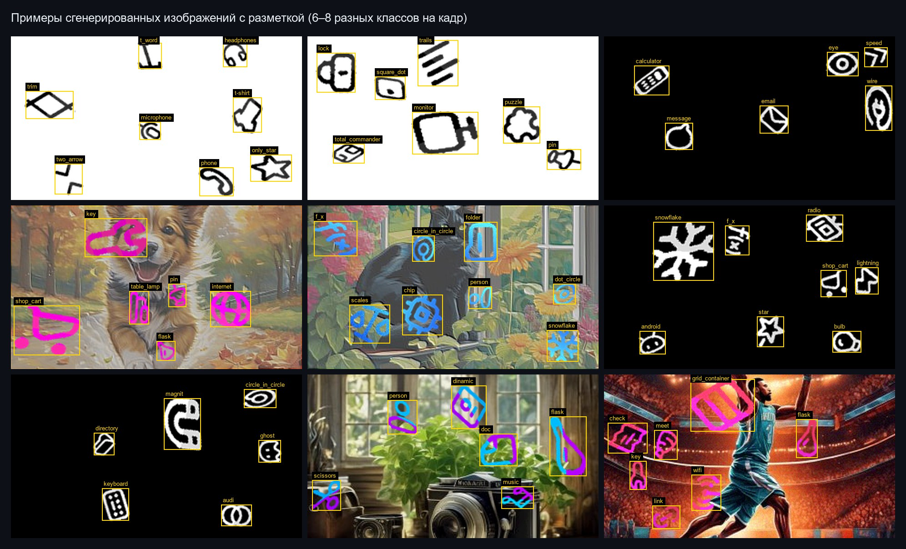

### Точность рамок

При бикубическом масштабировании и повороте вокруг объекта остаётся почти прозрачная
кайма. Раньше она попадала в рамку, и рамки были в среднем на 2–3 px шире видимого
объекта (на 12 % по площади). Сейчас рамка берётся по уровню 50 % прозрачности —
по границе исходной маски.

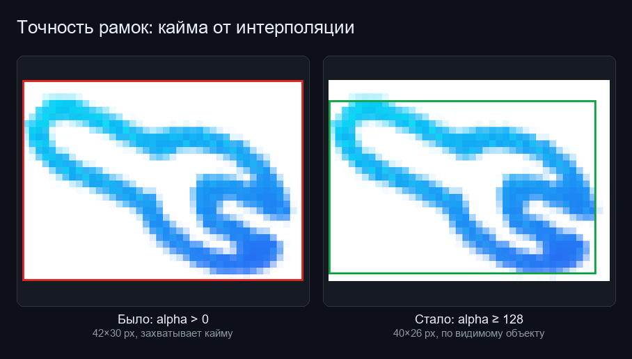

## Как обучалась модель

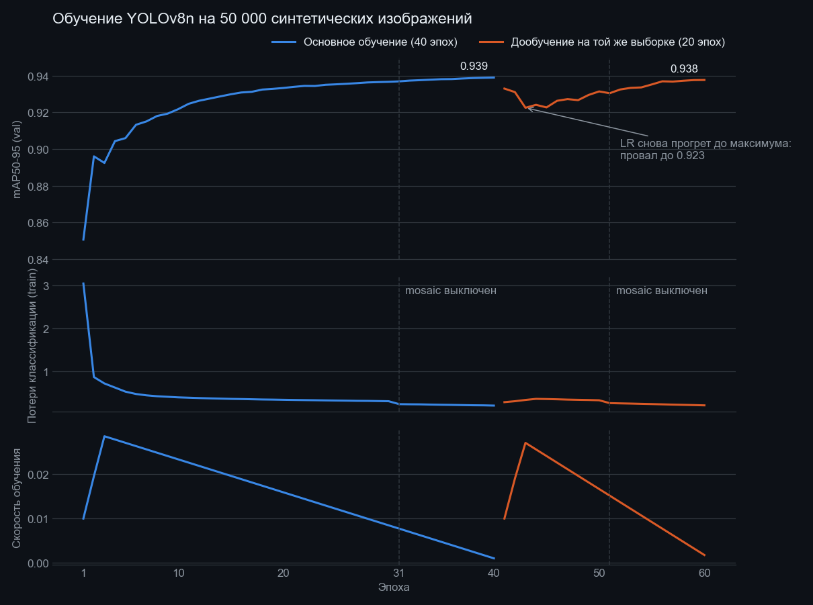

| Параметр | Значение | Почему |
|---|---|---|
| Стартовые веса | `yolov8n.pt`, предобучение на COCO | перенос общих признаков (края, формы); 319 из 355 тензоров переносятся, голова под 139 классов учится заново |
| Размер входа | 416 (исходные кадры 320×180) | увеличение помогает мелким объектам: на самой детальной карте признаков 52×52 ячейки вместо 40×40 |
| Эпохи | 40 | mAP50-95 выходит на плато к 30–35 эпохе |
| Batch / workers | 32 / 10 | помещается в 6 ГБ видеопамяти с AMP |
| Mixed precision (AMP) | включено | быстрее и меньше памяти |
| Оптимизатор | `auto` → MuSGD, lr 0.01, momentum 0.9, warmup 3 эпохи | выбран Ultralytics автоматически для длинного обучения (> 10 000 итераций) |
| Mosaic | включена, выключается за 10 эпох до конца | mosaic разнообразит сцены, последние эпохи на «чистых» кадрах доводят точность — на графике виден спад потерь на 31-й эпохе |
| Прочие аугментации | стандартные Ultralytics: HSV, сдвиг, масштаб, erasing | дополнительно к аугментациям генератора |
| Время | 4.6 ч, около 7 минут на эпоху | RTX 4050 Laptop |

**Почему дообучение не дало прироста.** Второй запуск шёл на побайтной копии той же
выборки, а `optimizer=auto` игнорирует `lr0` и снова прогревает скорость обучения
до максимума. Модель «встряхнулась» (провал до 0.923) и за 20 эпох вернулась почти
к исходному уровню (0.938 против 0.939). Правильное дообучение — на новых данных,
с явным оптимизатором, малым `--lr0` и без прогрева (см. [Дообучение](#дообучение-fine-tuning)).

## Результаты

Модель `runs/train/yolov8n_50k_maxspeed2/weights/best.pt` на валидации
(10 000 изображений, 69 825 объектов):

| Precision | Recall | mAP50 | mAP50-95 |
|---|---|---|---|
| 0.9994 | 0.9988 | 0.995 | 0.940 |

| | Классы (mAP50-95) |
|---|---|
| Лучшие | `container` 0.962, `zip_box` 0.957, `dinamic` 0.955, `3d_box` 0.955, `shop_cart` 0.955 |
| Худшие | `volume` 0.890, `dot_two_lines` 0.894, `back` 0.909, `a_word` 0.911, `eye` 0.914 |

Медиана по классам — 0.942. Хуже всего тонкие и «разреженные» иконки: у них ошибка
рамки в 1–2 px сильнее сказывается на IoU. Компактные «коробочные» иконки распознаются лучше всех.

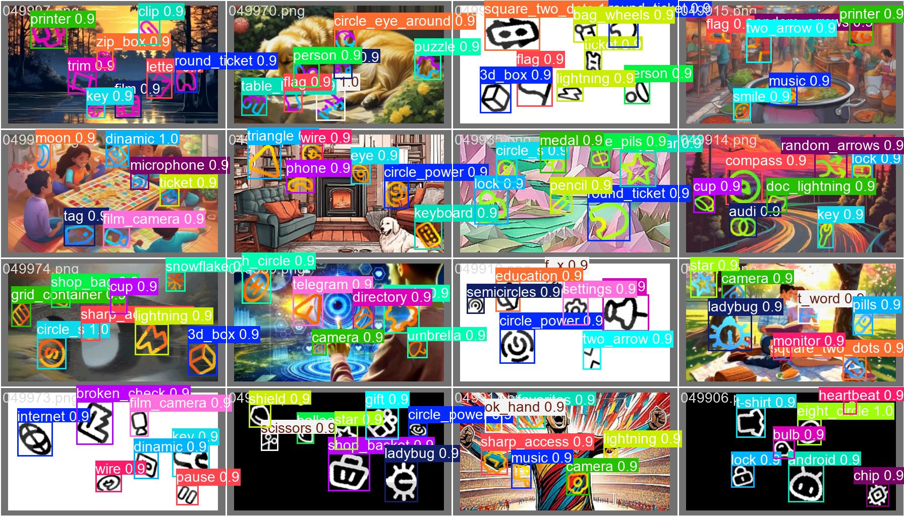

Скорость на ноутбуке: **7 мс** на кадр на RTX 4050 (из них 0.8 мс — сама сеть) и **40 мс**
на CPU i5-12500H. Первый запуск в GUI дольше (200–300 мс) из-за прогрева модели.

> **Ограничения.** Валидация синтетическая и порождена тем же генератором, поэтому
> метрики близки к потолку и не гарантируют такого же качества на реальных изображениях.
> Для честной оценки нужен отдельный размеченный набор реальных изображений.
> Все модели обучены до исправления рамок: на новой разметке у них mAP50-95 ниже
> (0.93 → 0.75 на одних и тех же изображениях), поэтому для выигрыша от точных рамок
> датасет нужно перегенерировать и модель переобучить.

## Быстрый старт

```bat
setup_train.bat      :: окружение для обучения (torch 2.5.1 + CUDA 12.1)
run_gui.bat          :: запуск GUI (при первом запуске ставит зависимости)
```

Версии зависимостей закреплены в `requirements.txt` и `requirements_gui.txt`.
Обученные модели лежат в `runs/train/*/weights/best.pt`, GUI подхватывает лучшую сам.

## Команды подробно

### Генерация датасета

```bat
python generate_dataset.py --output output_50k --count 50000 --num-workers 8 --no-preview
```

- Результат определяется `--seed` (по умолчанию 42), профилем `--bg-profile`,
  `--num-workers` и `--worker-chunk-size`. Для нового набора данных меняйте `--seed`.
- Выходная папка пересоздаётся, только если в ней лежит датасет этого генератора.
  Корень проекта, `objects/`, `backgrounds/` и их родительские папки удалить нельзя.
- `data.yaml` не содержит ключа `path`: пути считаются относительно самого yaml,
  датасет работает из любой папки и после переноса.

### Обучение

```bat
python prepare_yolo_model.py
python train_yolo.py --data output_50k/data.yaml --weights weights/yolov8n.pt ^
    --epochs 40 --imgsz 416 --batch 32 --workers 10 --name yolov8n_50k
```

`--fliplr` по умолчанию 0: отражения делает генератор с учётом классов-букв,
а отражение всего кадра в Ultralytics зеркалило бы и буквы.

### Дообучение (fine-tuning)

```bat
python train_yolo.py --data output_50k_seed7/data.yaml ^
    --weights runs/train/yolov8n_50k_maxspeed2/weights/best.pt ^
    --optimizer SGD --lr0 0.001 --warmup-epochs 0 --epochs 15 --imgsz 416 --batch 32 --name finetune_seed7
```

При `--optimizer auto` Ultralytics игнорирует `--lr0`, поэтому оптимизатор указывается явно.
При возобновлении (`--resume-from …/last.pt`) гиперпараметры берутся из чекпойнта;
менять можно только `--batch`, `--device`, `--workers`.

### Оценка на реальных изображениях

```
real_test/
  images/      *.png / *.jpg
  labels/      *.txt  (YOLO: class x_center y_center width height, нормированные)
  data.yaml    train: images, val: images, nc: 139, names: как в output_50k/data.yaml
```

```bat
python evaluate_model.py --weights runs/train/<run>/weights/best.pt --data real_test/data.yaml
```

Метрики и 10 худших классов сохраняются в `runs/val/<run>_<dataset>_val/metrics.json`.

### Тесты, иллюстрации, архив

```bat
.venv\Scripts\python -m unittest discover -s tests -t . -v
python docs/make_figures.py                                   :: пересобрать иллюстрации README
python make_archive.py --extra "presentation.pptx"             :: архив для сдачи
```

## Структура проекта

| Путь | Назначение |
|---|---|
| `generate_dataset.py`, `config.py`, `utils/` | генератор синтетического датасета |
| `train_yolo.py` | обучение, дообучение, возобновление |
| `evaluate_model.py` | оценка модели на размеченном наборе |
| `app_flet.py`, `gui/` | интерфейс: окно, графики, отчёты, выбор модели |
| `prepare_yolo_model.py` | скачивание предобученных весов в `weights/` |
| `download_backgrounds_uuid.py` | скачивание фонов |
| `objects/`, `backgrounds/` | исходные иконки и фоны |
| `runs/train/` | графики, `results.csv` и `best.pt` обученных моделей |
| `docs/` | иллюстрации README и скрипт для их сборки |
| `tests/` | автотесты |

## История экспериментов

| Запуск | Данные | Эпох | Время | mAP50 | mAP50-95 (val) |
|---|---|---|---|---|---|
| `yolov8n_gpu` (18.03) | ~7.4 тыс. изображений, imgsz 320 | 100 | — | 0.994 | 0.953 |
| `yolov8n_50k_maxspeed2` | `output_50k`, imgsz 416 | 40 | 4.6 ч | 0.995 | 0.939 |
| `yolov8n_50k_finetune_20260324` | копия `output_50k` | 20 | 2.2 ч | 0.995 | 0.938 |

- Первая строка не сравнима с остальными: другая валидационная выборка и параметры генерации.
- Точные флаги генерации `output_50k` не сохранились; параметры в таблице генератора —
  значения по умолчанию.
- Все запуски обучены на разметке до исправления рамок.

## Лицензия и правовая информация

- Код проекта распространяется под лицензией [GNU AGPL-3.0](LICENSE) — той же, что
  и [Ultralytics YOLOv8](https://github.com/ultralytics/ultralytics), на которой он построен.
  Обученные модели в `runs/train/` распространяются на тех же условиях.
- Изображения иконок в `objects/` принадлежат их правообладателю и включены только
  в учебно-исследовательских целях; лицензия проекта на них не распространяется.
- Фоны в `backgrounds/` сгенерированы сервисом [PicSUM:DEV](https://picsum.dev/license),
  условия которого разрешают использование изображений в любых проектах.
- Проект учебный: он показывает, насколько CAPTCHA на основе иконок уязвима для детекторов
  на компьютерном зрении. Не используйте его для обхода защиты сайтов без разрешения их владельцев.

© 2026 [int3re](https://github.com/int3re)
